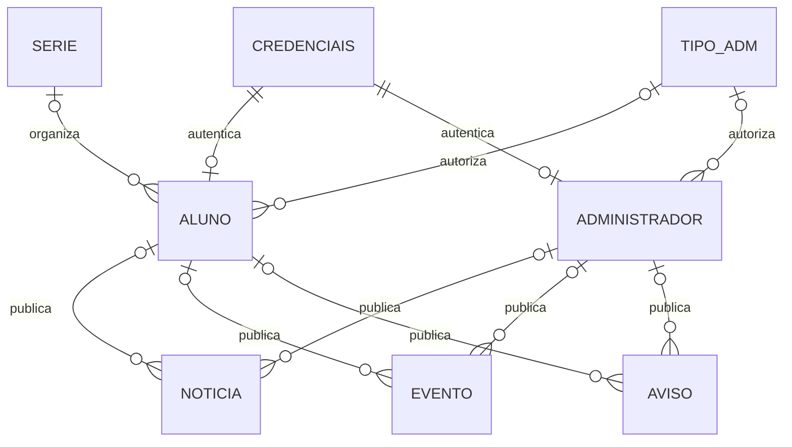

# Banco de dados e credenciais

Inspeção feita diretamente no MySQL local em 11/11/2026, utilizando a configuração existente, sem divulgar senhas nem hashes. O script [inspecionar_banco.php](../scripts/inspecionar_banco.php) é somente leitura e funciona apenas pela CLI.

## Estrutura real

MySQL 9.7.1; 8 tabelas InnoDB após a remoção de `escola` solicitada pelo responsável; utf8mb4/utf8mb4_bin. A collation diferencia letras maiúsculas/minúsculas no usuário. As FKs usam RESTRICT; por isso a exclusão da conta remove explicitamente suas publicações e seu perfil antes da credencial, dentro da mesma transação.

| Tabela | Responsabilidade e restrições relevantes |
| --- | --- |
| credenciais | Usuário único, senha com até 255 caracteres, ativo, foto, cadastro e último acesso. Não há mais UNIQUE sobre senha. |
| aluno | Nome/matrícula até 100, nascimento, série, credencial única e tipo administrativo opcional. Matrícula com índice UNIQUE após a migração. NULL permite matrícula não informada. |
| administrador | Nome/matrícula até 100, credencial única e cargo. Índice de matrícula pendente devido a duplicidade legada. |
| tipo_adm | Cargo e nível. Cargos institucionais existentes: IDs 1 Professor, 2 Administração, 3 Diretor Geral, 4 Sistema. |
| serie | Séries cadastradas, com nome único; os formulários usam os dados do banco. |
| noticia | Título 50, subtítulo 100 na base (80 na regra do DEF), texto, imagem, data, status e autor aluno ou administrador. |
| evento | Título 50, data e autor; não possui status nesta versão. |
| aviso | Título ampliado de 50 para 80, ativo e autor. |



Exclusividade de perfil e autoria são verificadas pela aplicação. Não existe constraint SQL que faça uma credencial pertencer exclusivamente a uma das duas tabelas de perfil. Na base inspecionada, não há credenciais sem perfil, com dois perfis nem publicações com autoria ausente/dupla.

Os arquivos [esquema_inicial.sql](../database/esquema_inicial.sql) e [esquema_atual.sql](../database/esquema_atual.sql) registram somente DDL, sem dados pessoais. O primeiro é um registro histórico anterior às mudanças e ainda descreve a antiga tabela `escola`; não representa a instalação atual. O segundo contém somente as 8 tabelas em uso. Os arquivos de modelagem que já estavam removidos antes da revisão continuam removidos.

## Alterações aplicadas na base original

Antes de alterar o esquema na revisão inicial, foi criado backup SQL completo fora da pasta do projeto, em `%LOCALAPPDATA%/PortalCETIDAM/backups/`. O nome exato dessa execução está em `tests/.artifacts/migration.txt`. Naquela etapa, as contagens e resumos SHA-256 dos registros de todas as tabelas foram comparados antes/depois e permaneceram idênticos. A exclusão posterior de `escola`, expressamente solicitada pelo responsável, está descrita abaixo.

1. Remoção do UNIQUE de senha. Senhas iguais entre pessoas passam a ter hashes aleatórios independentes, sem revelar igualdade.
2. Confirmação de `credenciais.senha VARCHAR(255)`, suficiente para password_hash.
3. Ampliação de `aviso.titulo` para 80 caracteres, conforme o DEF.
4. Criação do índice único de matrícula de aluno. Matrículas opcionais são gravadas como NULL.
5. O índice de administrador não foi aplicado: há um grupo de matrículas duplicadas preexistente. Nenhum registro foi apagado ou escolhido automaticamente como correto. A aplicação verifica novas matrículas nas duas tabelas, dentro das transações; uma trava no cadastro de tipos serializa essa verificação entre requisições da aplicação. Escritas diretas por administradores do banco precisam respeitar essa mesma regra.

O script [migrar_banco.php](../scripts/migrar_banco.php) verifica se o índice já existe antes de aplicar a mudança. DDL do MySQL não tem o mesmo rollback das operações de dados; por isso o backup é obrigatório e precede a migração.

### Remoção de escola

Por solicitação posterior do responsável, a migração [002_remover_escola.sql](../database/migracoes/002_remover_escola.sql) removeu a tabela `escola` e seus 20 registros. Foi criado outro backup privado completo antes do DROP, registrado em `tests/.artifacts/remocao_escola_migration.txt`. Esse backup anterior à exclusão mantém a possibilidade de recuperação; a tabela não existe no banco ativo.

As contagens e resumos dos registros das outras 8 tabelas foram comparados antes/depois e permaneceram iguais. Também foram retirados model, DAO e controller desse recurso e os testes de CRUD que deixaram de se aplicar. O comando `--apply` agora inclui essa remoção, com `DROP TABLE IF EXISTS`, permitindo repetir a migração sem erro se a tabela já estiver ausente.

```powershell
php scripts/inspecionar_banco.php
php scripts/migrar_banco.php --apply --admin
php scripts/migrar_banco.php --backup-only
```

`--admin` usa a credencial privada de manutenção. A aplicação web não a carrega. Backups regulares não precisam dessa credencial administrativa. `CETIDAM_BACKUP_DIR` permite escolher outro destino privado; `CETIDAM_STORAGE_DIR` define logs e sessões. Em Linux, configure diretórios graváveis pelo serviço e arquivos com acesso restrito.

## Senhas e acesso ao banco

A aplicação usa uma nova conta MySQL local, com apenas SELECT, INSERT, UPDATE e DELETE no banco do portal. Não usa mais root. A conexão com essa conta foi testada, e os privilégios foram verificados com SHOW GRANTS.

- `application/config.php`: credenciais privadas da própria instalação, mantidas na localização original por solicitação do responsável e retiradas do controle do Git. Acesso HTTP bloqueado pelas regras do portal.
- `application/config.example.php`: único modelo de configuração versionado, com valores fictícios.
- `application/bootstrap.php`: carrega o config.php, normaliza a conexão PDO/utf8mb4 e define as constantes comuns. Não contém credenciais. Aceita as definições de BASE_DIR e VIEW do config.php antigo.
- `config/maintenance.php`: credencial administrativa anterior, privada e utilizada somente pelas ferramentas CLI de manutenção/teste. Deve permanecer fora de uma distribuição pública e pode ser retirada do servidor web.
- Variáveis `CETIDAM_DB_HOST`, `CETIDAM_DB_PORT`, `CETIDAM_DB_NAME`, `CETIDAM_DB_USER` e `CETIDAM_DB_PASS` continuam disponíveis para executar os testes em uma base isolada. Na escola, sem essas substituições, os valores vêm diretamente de config.php.

Não há mais carregamento de `config/local.php`. As credenciais locais foram preservadas em `application/config.php`, com backup privado antes da retirada do arquivo intermediário. Como config.php já era versionado, sua retirada gera uma exclusão no primeiro pull: preservar e restaurar o arquivo da escola é obrigatório nessa transição, conforme [publicação e configuração](08_PUBLICACAO_E_CONFIGURACAO.md). Depois disso, alterações locais deixam de participar dos commits e pulls normais.

Novas senhas são calculadas no PHP com Argon2id, quando disponível, ou bcrypt. As antigas em SHA-256 continuam válidas e são substituídas após login correto de uma conta ativa. A inspeção final encontrou 27 hashes legados; não foram redefinidas senhas de usuários reais durante os testes.

A regra atual exige 8 caracteres, confirmação, diferença do nome de usuário e no máximo 72 bytes, compatível com o limite do bcrypt. Usuário/senha vazios na edição preservam os valores atuais. O servidor não aceita IDs de credencial ou cargos enviados pelo formulário para mudar o alvo da edição.

## Dados legados que exigem conferência

- Um grupo de matrículas repetidas entre administradores impede o índice UNIQUE dessa tabela. Confirmar os registros com o responsável antes de corrigir dados.
- Existem 6 tipos administrativos com níveis 5 a 10, fora do DEF, e outros registros de teste já presentes. O login recusa níveis fora dos intervalos permitidos. Nenhum desses registros foi removido automaticamente.
- Há uma conta administrativa de nível 4, conforme a unicidade prevista para o responsável técnico.
- A credencial root anterior permanece no histórico do Git. A retirada do segredo do código atual não apaga o histórico: é necessário rotacionar essa credencial e avaliar os locais onde o repositório foi compartilhado. Não foi alterada a senha root usada por outras ferramentas/serviços desta máquina.

Não existem tabelas/modelos ativos de Contato e Endereço nessa base. Seus DAOs são esboços sem rota; não foram criadas essas funcionalidades ou views institucionais.
